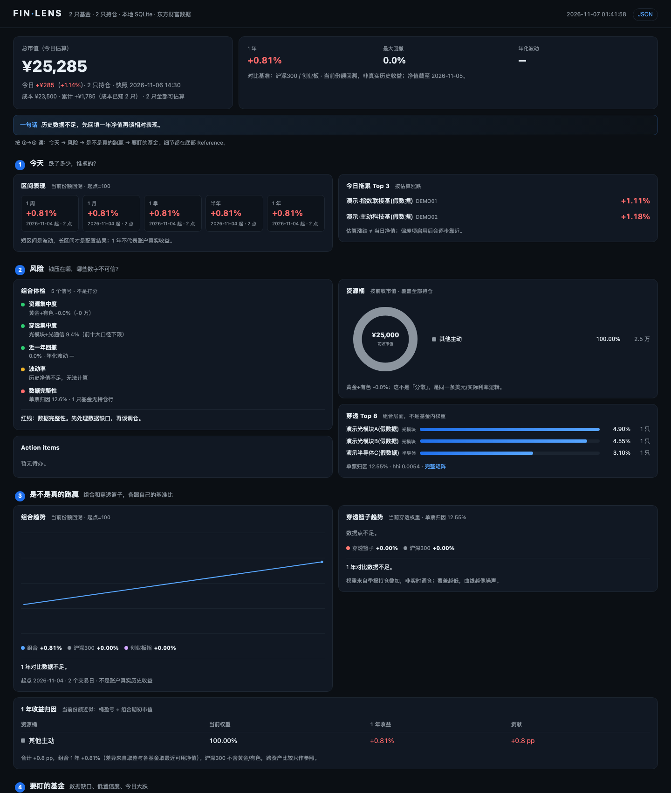

# fin-lens

一个本地基金穿透估值 / 重叠监控台：Rust 进程 + SQLite 文件，没有 Redis、没有消息队列、没有前端构建链。

> 名字是骗人的，持仓不是。这个项目的唯一目的：把「你以为的分散」还原成「你实际持有的那几只票」。

项目只提交**引擎、方法、阈值与演示数据**。真实基金池、持仓、金额、成本、盈亏、截图与日报全部留在本机 `data/private/`，不进入 Git。如何接入自己的组合见 [docs/onboarding.md](docs/onboarding.md)。

## 快速开始（DEMO）

```bash
export CARGO_HOME="$PWD/.cargo-home"   # 沙箱/受限环境需要；普通环境可省略

cargo run                              # 使用 data/finlens.db（自动建库、跑迁移）
FINLENS_SEED_DEMO=1 cargo run          # 空库时写入 DEMO01/DEMO02 两只假基金
cargo test                             # 内核单测 + schema/端到端集成测试
```

默认监听 `127.0.0.1:8787`。Dashboard 在 `/`，JSON 端点：

```bash
curl -s localhost:8787/healthz
curl -s localhost:8787/api/funds | jq            # 基金字典
curl -s localhost:8787/api/estimates | jq        # 全部基金批量估值
curl -s localhost:8787/api/funds/DEMO02/estimate | jq
curl -s localhost:8787/api/lookthrough | jq
```

`estimate` 返回的 `flags` / `coverage` / `confidence` 是给人看的：缺行情、beta 被夹紧、残余仓位没有代理、穿透覆盖不足，都会明说，绝不假装精确。

### 接入自己的组合

1. 按 [docs/onboarding.md](docs/onboarding.md) 创建 `data/private/funds_source.json` 与 `data/private/portfolio_<date>.json`。
2. 用 `docs/examples/inputs/` 里的虚构模板对照字段。
3. 运行 `python3 collector/validate_inputs.py` 做离线结构校验。
4. 按顺序生成种子并灌库（见 onboarding）。

真实输入不在仓库里；新克隆只有 DEMO 数据。

### 环境变量

| 变量 | 默认 | 说明 |
| --- | --- | --- |
| `FINLENS_BIND` | `127.0.0.1:8787` | 监听地址 |
| `FINLENS_DB` | `data/finlens.db` | SQLite 路径 |
| `FINLENS_DAILY_DIR` | `data/daily` | 盘后日报目录 |
| `FINLENS_OVERLAP_ALERT` | `0.05` | 单票穿透告警阈值（5%） |
| `FINLENS_EWMA_LAMBDA` | `0.25` | 偏差 EWMA 的 λ |
| `FINLENS_EWMA_MIN_OBS` | `3` | 少于该观测数不启用偏差 |
| `FINLENS_EWMA_CLAMP` | `0.003` | 偏差项绝对值上限（±0.3%） |
| `FINLENS_EWMA_HALF_LIFE` | `10` | 偏差衰减半衰期（交易日） |
| `FINLENS_SEED_DEMO` | 空 | `1`/`true` 时在空库写入演示数据 |

采集脚本另有 `FINLENS_PRIVATE_DIR`、`FINLENS_PORTFOLIO_PATH`、`FINLENS_SEED_DIR`，也可以直接用 `--private-dir` / `--portfolio` / `--out`。

## 数据边界

真实数据只走离线链路：

```
data/private/*.json → collector/build_*.py → seeds/*.sql → fin-lens seed → data/finlens.db
```

Rust 运行时只读 SQLite，不访问网络；Python 只产出 SQL，不连接数据库。

私有输入与生成物：

- `data/private/funds_source.json`：基金池、标的字典、季报持仓、基准。
- `data/private/portfolio_<date>.json`：市值、成本/收益率、新增基金、A/C family、资源桶。
- `seeds/`：生成的 SQL，含个人份额/成本，整体忽略。
- `data/finlens.db`、`data/daily/`、`state/`：运行时事实、日报与本地状态，整体忽略。
- `data/private/notes/` 与 `AGENTS.local.md`：本机状态/基线/经验，忽略。

边界、备份与误提交处理见 [docs/private-data.md](docs/private-data.md)。

## 架构

```
collector/*.py  ──(SQL seed)──►  fin-lens seed  ──►  SQLite (data/finlens.db)
                                                          ▲
                                                          │
                                              Rust: axum + sqlx
                                                          │
                                                   HTMX 页面 / JSON API
```

依赖方向（单向，不得回指）：

```
api / demo  ──►  db::repo  ──►  domain
   │                               ▲
   └───────────────►  config / error
```

- **`domain/`**：纯函数估值内核。不碰 I/O、不读时钟、不生成随机数，因此能用固定输入精确断言。
- **`db/repo.rs`**：全项目唯一写 SQL 的地方。只接受/返回行结构，业务语义留在 `domain`。
- **`service.rs`**：估值装配、穿透、组合汇总、历史回溯；API、UI、`validate` 共用同一条路径。
- **`api/`**：薄适配层。取参数 → 查库 → 调内核 → 序列化。
- **`ui.rs`**：HTMX 页面，只读渲染；不查业务、不缓存、不做第二套估值。
- **`collector/`**：只抓取/生成 SQL，不连接数据库，不知道表结构。

## 估值内核

四种模式：

| 模式 | 适用 | 公式 |
| --- | --- | --- |
| `transparent` | 指数联接基、黄金/商品代理 | `prev_nav × (1 + β·benchmark_pct + fx) + bias` |
| `semi_transparent` | 季报披露前十大重仓的主动基 | `prev_nav × (1 + Σwᵢ·pctᵢ + w_residual·proxy + bias)` |
| `opaque` | 披露不足、只能拿基准硬估 | `prev_nav × (1 + 0.90·benchmark_pct + bias)`，置信度 ×0.45 |
| `qdii` | 跨境 QDII | `prev_nav × ((1 + β·美股T-1) × (1 + fx) − 1 + bias)` |

QDII 分支：A 股白天美股休市，只能用**上一夜美股收盘涨跌**（配置的美股行业指数代理），同时乘上 **USD/CNY 汇率变动**（正值 = 人民币贬值）。公式保留 `(1 + benchmark) × (1 + fx)` 的交叉项，而不是把两项简单相加，这是人民币净值的精确复利口径。库里 `fund.mode` 仍存 `transparent`，由 `category='qdii_index'` 判定走 QDII 分支；响应里 `mode` 会显示为 `qdii`，并附 `qdii: {benchmark, us_pct, fx_pct, beta, lag_days}` 明细。缺失的当日净值不会伪造。

`β`（跟涨系数）不是拍脑袋的：用近 20 个交易日 `fund_pct = α + β·benchmark_pct` 做 OLS 回归，写入 `tracking_fit`。缺失时回退到基金表里的静态值，并在 `flags` 标注 `BetaClamped` / `BetaMissing`。

### 偏差自校准（EWMA）

基金公司净值会在深夜更新，估值与真实的差值就是模型误差。我们记录 **收益率空间**的残差 `actual_pct − raw_estimated_pct`，λ=0.25 做 EWMA，按 10 日半衰期衰减后叠加到次日估算。

三个刻意的设计：

1. **残差用「未加偏差项」的原始估算计算**，否则偏差会自我强化成反馈回路。
2. **偏差项夹紧在 ±0.3%**，并且 `n_obs < 3` 时不启用。宁可承认「今天估不准」，也不让校准漂移失控。
3. 单日残差绝对值 > 5% 视为脏数据（分红、拆分、数据错位），拒绝入样，打 `outlier`。

### 穿透重叠矩阵

`position` 表存**真实投入市值占比**（不是基金数量等权）。对每只基金取最新一期持仓，按组合权重加权汇总每只标的的穿透暴露：

```
穿透权重(股票 S) = Σ_funds  fund_weight × holding_weight(S in fund)
```

单票穿透 > `overlap_alert_threshold`（默认 5%）即红灯；≥ 2 倍阈值为 critical。同时输出行业暴露、HHI、基金间共同持仓明细，回答「这几只基金到底重不重」。

资源桶由 `bucket_member` 表驱动，不在 Rust 里写死基金/ETF 代码；没有配置桶的 ETF/联接基会显示为「未分类」，避免静默误分类。

没有录入仓位时退化为等权，并在响应里标 `weights_assumed_equal: true` —— 此时矩阵只看相对结构，别当成真实暴露。

## Dashboard



首屏是 One-pager，按固定阅读顺序回答四个问题（页面标题里的 ①→④）：

1. **今天**：总市值、今日预估盈亏、1 周 / 1 月 / 1 季 / 半年 / 1 年区间收益；右侧列出今日拖累前三。
2. **风险**：5 条确定性体检（资源集中度、穿透集中度、一年回撤、波动、数据完整性）+ 按严重度排序的 Action items；右侧是资源桶 donut 和穿透 Top 8。
3. **是不是真的跑赢**：组合 vs 沪深300/创业板、穿透篮子 vs 沪深300，各配一句确定性结论；下面用「桶盈亏 ÷ 组合期初市值」拆 1 年收益归因（当前份额近似）。
4. **要盯的基金**：数据缺口、低覆盖率、今日跌幅超 5% 的基金，按原因数量排序；这是核对清单，不是买入/卖出建议。

顶部还有一条「一句话」：把 1 年超额、最大贡献桶、最大拖累桶、回测口径限制和穿透篮子的不可交易性压成一句，先看这句再看细节。逐只明细折叠在页面底部 `Reference`。

细节口径：

- **顶部 Hero**：总市值（今日估算）、今日盈亏、1 年收益、近一年最大回撤、年化波动；区间收益从数据实际起点算起，短样本不会伪装成完整窗口。
- **组合体检**：5 条规则，红/黄/绿三档，不做加权打分。阈值固定（资源 25%/40%、回撤 12%/20%、波动 25%/35%、单票归因 80%/60% 反向），当前红黄线由页面实时计算。
- **资源桶 donut**：按前收市值分桶；黄金+有色是另一条美元/实际利率逻辑，不能和「光模块/算力」混算成行业分散。
- **收益归因**：用当前份额 × 各基金期初/期末净值，把 1 年收益拆到资源桶；贡献加总≈组合 1 年收益（取整与最近可用净值会有小差）。它解释「为什么跑赢」，但不构成择时能力证据。
- `/partials/overview` 每 30s 局部刷新（轮询，不是 SSE）；`/` 与 JSON API、`validate` 共用同一套 `service` 装配。

页面对每个可能误读的数字都加了限定：趋势标注「当前份额回溯，非真实历史收益」；穿透标注「单票归因覆盖率」；成本未知的基金显示「—」而不是 0。

## 历史回溯与体检

`collector/build_history.py` 回填一年历史净值 + 持仓个股/指数日线，写 `seeds/history_<as_of>.sql`：

- 基金历史净值来自 `pingzhongdata` 的 `Data_netWorthTrend`（一次请求拿全历史）。
- 持仓个股/指数用 `push2his` kline（一年一次取完，前复权）。
- 全部 `ON CONFLICT DO NOTHING`，保留已有精确口径。

三个必须说清的限制：

1. 组合曲线用**当前份额**回放历史净值，不是账户真实历史收益；它回答的是「如果今天这套仓位拿了一年，会怎样」。
2. 短/中/长「风险」是**已实现**波动、回撤与情景，不是未来预测。
3. 穿透篮子只含单票归因权重：ETF 联接基只展开目标 ETF 前十大，黄金用商品代理，穿透曲线会系统性低估真实暴露，所以它只是下限，不是答案。

健康度阈值：资源集中度 25% 黄 / 40% 红；光模块+光通信簇 10% / 20%；近一年回撤 12% / 20%；年化波动 25% / 35%；数据完整性 80% / 60%（反向）。改阈值前先问：这是为了好看，还是为了更早发现风险？

## Schema 速览

21 张表，全部 `STRICT`（SQLite 3.37+），日期一律 `TEXT` ISO-8601（`YYYY-MM-DD`），不用 `DATE`/`DATETIME` 类型：

| 层 | 表 | 职责 |
| --- | --- | --- |
| 字典 | `instrument` | 统一标的：股票/指数/ETF/黄金/债券，含 `kind`、`sector`、`source_symbol` |
| 字典 | `fund` | 基金主表：`mode`、`benchmark_code`、`etf_code`、静态 `tracking_beta` |
| 事实 | `nav` | 每日单位净值 + 日涨跌，PK `(fund_code, trade_date)` |
| 事实 | `holding` | 季报前十大，PK `(fund_code, report_date, instrument_code)` |
| 事实 | `fund_allocation` | 股票/债券/现金/其他占比，用于算残余仓位 |
| 事实 | `quote_snapshot` | 盘中报价（`trade_date` 内多次），`quote_daily` 为收盘快照 |
| 事实 | `position` | 用户真实持仓市值与权重；`portfolio_snapshot` 记录总市值时点 |
| 事实 | `trade` / `position_lot` | 多笔买入/卖出流水（`external_id` 幂等）+ FIFO 批次 |
| 字典 | `fund_family` | A/C 类合并：同一组合的不同收费份额 |
| 配置 | `bucket` / `bucket_member` | 黄金/有色/光模块/算力/半导体/宽基/原油/医药等资源桶 |
| 派生 | `estimate` | 每次估算落库：nav、覆盖率、置信度、`flags_json`、`is_final` |
| 派生 | `calibration` | 残差 + EWMA 状态（bias/abs/n_obs/lambda/outlier） |
| 派生 | `tracking_fit` | 回归结果（β/α/R²/样本数） |
| 派生 | `lookthrough_exposure` | 每日穿透暴露快照，便于看集中度漂移 |
| 运维 | `alert`、`ingest_batch`、`setting` | 告警、采集幂等、运行时参数 |

9 个视图直接给最新一期/派生数据：`v_latest_nav`、`v_latest_holding`、`v_latest_allocation`、`v_latest_estimate`、`v_latest_lookthrough`，以及组合域的 `v_lot_position`、`v_position_live`、`v_family_position`、`v_trade_flow`。

迁移文件在 `migrations/`，由 `sqlx::migrate!` 在启动时自动执行（事务内）。WAL / `busy_timeout` / `foreign_keys` 等 PRAGMA 放在 `SqliteConnectOptions`，不写进迁移。

## 目录

```
fin-lens/
├── Cargo.toml
├── migrations/
│   ├── 0001_init.sql
│   ├── 0002_settings.sql
│   ├── 0003_portfolio_trades.sql
│   ├── 0004_position_notes.sql
│   └── 0005_bucket_medical.sql
├── src/
│   ├── main.rs              # 子命令：serve / seed <sql> / validate <date>
│   ├── lib.rs
│   ├── config.rs
│   ├── error.rs
│   ├── api/mod.rs
│   ├── ui.rs
│   ├── service.rs
│   ├── validate.rs
│   ├── db/{mod,repo}.rs
│   ├── domain/              # 纯函数内核（valuation/calibration/lookthrough/fit/risk）
│   └── demo.rs              # 演示数据（DEMO.* 前缀，仅空库写入）
├── static/htmx.min.js       # 本地托管，Dashboard 不依赖 CDN
├── collector/               # Python 采集/种子生成
│   ├── config.py
│   ├── validate_inputs.py
│   ├── build_seed.py
│   ├── build_portfolio.py
│   ├── build_etf_lookthrough.py
│   ├── build_history.py
│   └── sample/              # 虚构的 ingest 样例
├── docs/
│   ├── onboarding.md        # 接入自己的组合
│   ├── private-data.md      # 私有数据边界
│   ├── data-lineage.md      # 数据管线与表血缘
│   ├── examples/            # 虚构输入模板
│   └── dashboard-demo.png   # DEMO 截图
├── tests/schema_and_kernel.rs
├── AGENTS.md
└── .agent/skills/           # 运维工作流技能
```

`seeds/`、`data/`、`state/`、`AGENTS.local.md` 与本地数据库均被 `.gitignore` 忽略。

## 路线图

1. **引擎与首版数据链路（已完成）**：Cargo 骨架、STRICT 表 + 视图、四类估值纯函数、EWMA、穿透矩阵、JSON 端点。
2. **私有数据接入（已完成首版）**：基金池、市值/成本、A/C、资源桶、在途现金；具体数字只存本机。
3. **采集层**：`collector/` 拉东方财富净值与盘中报价 → SQL seed → `quote_snapshot`。
4. **轮询调度**：Tokio 长生命周期 Task，只轮询当前页面可见标的，`quote_stale_seconds` 超时即降级标注。
5. **Dashboard（Phase A 完成）**：One-pager、1 年组合/穿透趋势、5 信号体检、Action items 已上线；SSE 增量推送、单基金详情、校准曲线、个股贡献与压力测试（Phase B）待接。
6. **盘后校准**：`fin-lens validate <date>` 完成「估值 → 对照真实净值 → 残差 → calibration → 日报」闭环；满 3 个观测后偏差项自动生效。

## 给 AI Agent

仓库根目录的 `AGENTS.md` 固化了「什么不能改」：domain 纯净、repo 唯一 SQL、真实数据不进 migrations、ETF 基准必须用净值口径、取历史严格小于 as_of。`.agent/skills/` 是操作员工作流，只描述「什么时候按什么顺序跑哪些命令」，不承载估值逻辑。

本机私有状态放在 `AGENTS.local.md` 与 `data/private/notes/`（均忽略）。不要把金额、成本、盈亏、当前权重或逐只验证结果写进任何提交文件。
